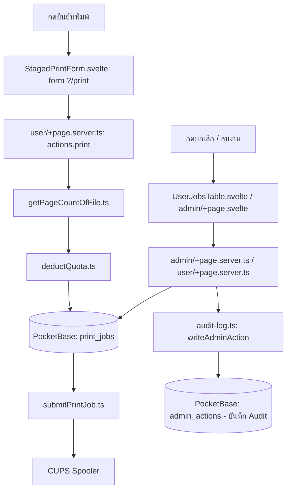

# Printer-server — กดแล้วโค้ดไปไหน

| ผู้ใช้ทำอะไร | ตามไฟล์และฟังก์ชัน | ผลลัพธ์ |
| :--- | :--- | :--- |
| **เลือกไฟล์และตัวเลือกพิมพ์** | [StagedPrintForm.svelte](src/lib/components/Print-Com/user/StagedPrintForm.svelte) เก็บ staged file, copies, sides, color | ยังไม่ส่งงานไป CUPS |
| **กดยืนยันพิมพ์** | `confirmPrint()` → `handleFormSubmit()` ส่ง XHR ไป `?/print` ใน [StagedPrintForm.svelte](src/lib/components/Print-Com/user/StagedPrintForm.svelte) → `actions.print` ใน [user/+page.server.ts](src/routes/user/+page.server.ts) → [getPageCountOfFile.ts](src/lib/server/functions/print/getPageCountOfFile.ts) → [deductQuota.ts](src/lib/server/functions/quota/deductQuota.ts) → สร้าง `print_jobs` → [submitPrintJob.ts](src/lib/server/functions/print/submitPrintJob.ts) | ตรวจไฟล์/โควตา, บันทึก metadata ลง `print_jobs`, ส่งไฟล์เข้า CUPS spooler (ไม่เก็บไฟล์ใน PB) |
| **กดยกเลิกงาน** | form `?/cancel` ใน [UserJobsTable.svelte](src/lib/components/Print-Com/user/UserJobsTable.svelte) → `actions.cancel` ใน [user/+page.server.ts](src/routes/user/+page.server.ts) → [cancelPrintJob.ts](src/lib/server/functions/print/cancelPrintJob.ts) และ [refundQuota.ts](src/lib/server/functions/quota/refundQuota.ts) | เปลี่ยนสถานะงาน คืนโควตา และบันทึก Audit ลง `admin_actions` |
| **แอดมินลบ / ระงับงานพิมพ์** | [admin/+page.svelte](src/routes/admin/+page.svelte) → `actions.remove`/`suspend` ใน [admin/+page.server.ts](src/routes/admin/+page.server.ts) | อัปเดต/ลบงานพิมพ์ และบันทึก Audit ลง `admin_actions` ผ่าน `writeAdminAction()` |
| **แอดมินปรับโควตา** | [admin/+page.svelte](src/routes/admin/+page.svelte) → `actions.adjustQuota`/`resetQuota` ใน [admin/+page.server.ts](src/routes/admin/+page.server.ts) | แก้ไขข้อมูลในคอลเลกชัน `Quota` |

อ่าน [คู่มือระบบ](../Docs/HandOn/printer-server.md) สำหรับ CUPS และกติกา quota
